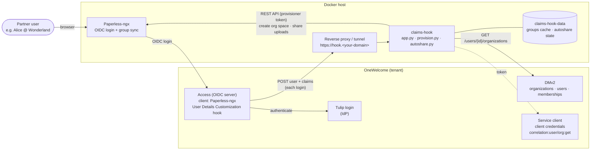
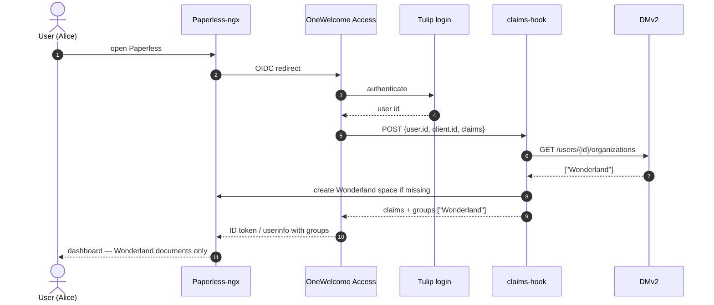

# OneWelcome B2B × Paperless-ngx — Reproduction Runbook

> Generic, anonymised write-up of a demo setup. All tenant names, domains, IDs and secrets are placeholders.

Step-by-step record of how the OneWelcome (OIP) B2B demo with Paperless-ngx was built, so it can be rebuilt later.

> **Masking:** secrets, tokens and passwords are replaced with `<…>` placeholders. Tenant-specific IDs are shown where they are needed to reproduce the setup; replace them with your own values in a new tenant.

---

## 0. Overview

**Goal:** External partner organizations managed in OneWelcome DMv2 automatically get their own isolated space in Paperless-ngx.

| Component | Role |
|---|---|
| OneWelcome **DMv2** | Source of truth: organizations, users, memberships, access role `Paperless-User` |
| OneWelcome **Access** | OIDC server for the `Paperless-ngx` client; calls a *User Details Customization* hook at each login |
| **Tulip** login (IdP `<tulip-idp-id>`) | Authenticates the users (DMv2 users live here) |
| **claims-hook** (Docker) | Webhook: looks up the user's DMv2 organizations → returns `groups` claim; auto-provisions org spaces in Paperless; auto-shares uploads |
| **Paperless-ngx** | Document app; OIDC login + group sync; per-org group, tag, storage path, workflow |

**Login flow (simplified):** User → Paperless → Access (OIDC) → Tulip login → Access calls claims-hook → hook asks DMv2 for the user's orgs → hook ensures org space in Paperless → returns `groups: ["<Org>"]` → Paperless syncs user into that group.

**Environment used**

| Item | Value |
|---|---|
| OneWelcome tenant | `<tenant>` (gateway `https://<tenant>.gw.<oip-region-domain>`) |
| Admin Portal | `https://<admin-portal-host>/` |
| Access Admin | `https://<tenant>.gw.<oip-region-domain>/access-admin/` |
| DM-UI | `https://<tenant>.gw.<oip-region-domain>/dm-ui/` |
| IO | `https://<tenant>.gw.<oip-region-domain>/io/` |
| Paperless-ngx | `https://paperless.<your-domain>` (v3.3.1, Docker) |
| Hook public URL | `https://hook.<your-domain>/<HOOK_SECRET>` (Cloudflare Tunnel) |

---


## Architecture — how the pieces connect

### Components



| From → To | What happens | Configured in |
|---|---|---|
| Paperless → Access | Standard OIDC login (authorization code) | Paperless `PAPERLESS_SOCIALACCOUNT_PROVIDERS` ↔ Access web client *Paperless-ngx* (§1, §6.1) |
| Access → Tulip | Access delegates authentication to the Tulip IdP | Web client → *Identity provider* (§1) |
| Access → claims-hook | At every login (token + userinfo) Access POSTs the user and claims; the hook may add claims | Access *Web Hooks* + client OIDC config (§4) |
| claims-hook → DMv2 | Reads the user's organizations (enabled, membership valid today) | Service client (§3), `DM_BASE`, `OIP_TOKEN_URL` |
| claims-hook → Paperless API | Creates the org's group/tag/storage path/workflow if missing; shares new uploads with the uploader's org | `PAPERLESS_TOKEN`, `PAPERLESS_API` (§5) |
| Paperless | Syncs the user's groups from the `groups` claim | `PAPERLESS_SOCIAL_ACCOUNT_SYNC_GROUPS=true` (§6.1) |

### Login sequence



### Worked example — onboarding a new partner "Wonderland"

| Step | Who / where | Result |
|---|---|---|
| 1 | Admin, DMv2: create org **Wonderland**, attach access role **Paperless-User** | Org exists in OneWelcome |
| 2 | Admin, DMv2: invite **Alice** into Wonderland | Alice sets her password (Tulip) |
| 3 | Alice opens Paperless and signs in | Access calls the hook |
| 4 | claims-hook asks DMv2 | `GROUPS <alice-id>: ['Wonderland']` |
| 5 | claims-hook → Paperless API (first Wonderland login only) | `PROVISION group/tag/storage path/workflow 'Wonderland' created` |
| 6 | Paperless group sync | Alice ∈ group *Wonderland* |
| 7 | Alice uploads `Alice_in_Wonderland.pdf` | within ~10 s: `AUTOSHARE doc … -> ['Wonderland']` |
| 8 | Bob (Wonderland) / Robinson (Despair) log in | Bob sees the file; Robinson does not |
| 9 | Admin ends Alice's membership in DMv2 | next login: `groups: []` → access removed |

No Paperless admin action is needed for steps 3–9.

---

## 1. OneWelcome — Paperless OIDC client

Access Admin → **Configuration → Web clients** → client **Paperless-ngx**.

| Setting | Value |
|---|---|
| Client ID | `<PAPERLESS_CLIENT_ID>` (64-hex, generated) |
| Client secret | `<PAPERLESS_CLIENT_SECRET>` |
| Authentication | Client secret (basic) |
| Grant type | Authorization code |
| Redirect URL | `https://paperless.<your-domain>/accounts/oidc/onewelcome/login/callback/` |
| Default scopes | `openid profile email` (+ `paperless`, optional/unused) |
| Identity provider | **`<tulip-idp-id>`** (Tulip) |
| Post logout redirect | `https://paperless.<your-domain>/` |
| OIDC config → **User Details Customization Hook** | `Paperless groups claim` (see §4) |

> Do **not** use *Customize Access Token Web Hook* — Paperless reads userinfo/ID token, not the access token.

---

## 2. OneWelcome DMv2 — application, role, organizations

DM-UI, context **root**.

### 2.1 Register the application
Applications → **Add application → Federated application** → select **Paperless-ngx**
- Application URL: `https://paperless.<your-domain>/`
- ☑ Show application in Self Service portal
- Permissions tab → Add: `Read` (`paperless:read`), `ReadWrite` (`paperless:readwrite`)

### 2.2 Access role
Access Roles → **Add access role** `Paperless-User` → Add applications → Paperless-ngx → permission **ReadWrite**.

### 2.3 Organizations (partners)
For each partner org (demo: **Despair**, **Stark**, **Wonderland**):
1. Organizations → **Add organization** (simple name, no slashes — it becomes the Paperless group/tag/folder name).
2. Organization → **Access Roles** → *Add access roles to organization* → `Paperless-User`.
3. Switch context to the org → Users → **Invite user** → assign `Paperless-User` → Send invite.

> DMv2 permissions (`paperless:readwrite`) appear in the **access token** only; they are not used by Paperless. Org membership drives access.

---

## 3. OneWelcome — service client for the hook (DMv2 reader)

Access Admin → Web clients → **Add Web client**

| Setting | Value |
|---|---|
| Name | `claims-hook DM reader` |
| Client ID / secret | Generate → store as `DM_CLIENT_ID` / `DM_CLIENT_SECRET` (`<masked>`) |
| Authentication | Client secret (basic) |
| Grant type | **Client credentials** only |
| Default scopes | `correlation:user:get`, `correlation:organization:get` |

DM API used by the hook: `GET https://<tenant>.gw.<oip-region-domain>/dm/correlation/api/v1/users/{userId}/organizations`
Token endpoint: `https://<tenant>.gw.<oip-region-domain>/oauth/token`

---

## 4. OneWelcome — register the webhook

Access Admin → **System → Web Hooks → Add Web Hook Configuration**

| Setting | Value |
|---|---|
| Name | `Paperless groups claim` |
| Type | **User Details Customization** |
| Endpoint | `https://hook.<your-domain>/<HOOK_SECRET>` |
| Authentication | No Authentication (secret path) — *upgrade to Basic/JWT later* |

Then: Web clients → Paperless-ngx → **Edit OpenID Connect configuration** → User Details Customization Hook = `Paperless groups claim`.

**Hook contract observed** (Access → hook, POST, called twice per login: `/oauth/v1/token` and `/oauth/v1/userinfo`):
```json
{
  "user":   { "id": "<user-id>" },
  "client": { "id": "<client-id>" },
  "scopes": ["profile","openid","email"],
  "claims": { "sub": "…", "email": "…", "name": "…", "…": "…" },
  "executionContext": { "triggeredBy": "/oauth/v1/token", "correlationId": "…" },
  "contextCustomParams": {}
}
```
**Reply:** same object with `claims.groups` added. (Claims `iss`, `aud`, `sub`, `group_permissions` are protected.)

> An IO *Webhook* flow URL (`/io/flow/api/webhook?...`) was tried first and returned **405** — Access cannot call IO webhook flows this way. Use an external endpoint.

---

## 5. Docker host — claims-hook

Folder: `/opt/paperless/` (same compose project as Paperless).

### 5.1 Files
```
/opt/paperless/
├── docker-compose.yml
├── docker-compose.env          # Paperless settings
├── .env                        # secrets (chmod 600)
├── claims-hook/
│   ├── app.py                  # webhook: DMv2 lookup → groups claim (+ cache fallback)
│   ├── provision.py            # create org group/tag/storage path/workflow in Paperless
│   └── autoshare.py            # share new uploads with owner's org (every 10 s)
└── claims-hook-data/           # groups-cache.json, autoshare-state.json
```

### 5.2 `docker-compose.yml` (service excerpt)
```yaml
  claims-hook:
    image: python:3.12-alpine
    container_name: paperless-claims-hook
    restart: unless-stopped
    working_dir: /app
    volumes:
      - ./claims-hook:/app:ro
      - ./claims-hook-data:/data
    command: ["python", "-u", "app.py"]
    ports:
      - "127.0.0.1:8080:8080"          # only reachable via local Cloudflare tunnel
    environment:
      HOOK_SECRET: "${HOOK_SECRET}"
      DM_CLIENT_ID: "${DM_CLIENT_ID}"
      DM_CLIENT_SECRET: "${DM_CLIENT_SECRET}"
      PAPERLESS_CLIENT_ID: "<PAPERLESS_CLIENT_ID>"   # only act for this OIDC client
      EXCLUDE_ORGS: "root"
      DEBUG: "1"                                     # set "0" when stable
      # provisioning + autoshare
      PAPERLESS_TOKEN: "${PAPERLESS_TOKEN}"
      PAPERLESS_API: "http://paperless-webserver:8000"
      PAPERLESS_HOST: "paperless.<your-domain>"
      TEMPLATE_GROUP: "Despair"
      AUTO_PROVISION: "1"
      AUTOSHARE_INTERVAL: "10"
```

### 5.3 `.env` (masked)
```env
HOOK_SECRET=<openssl rand -hex 24>
DM_CLIENT_ID=<from §3>
DM_CLIENT_SECRET=<from §3>
PAPERLESS_TOKEN=<API token of Paperless user "provisioner">
```

### 5.4 Logic summary
- **app.py** — validates secret path; only for `PAPERLESS_CLIENT_ID`; gets client-credentials token (cached); `GET /users/{id}/organizations`; keeps only `status == ENABLED` orgs with a currently valid `is_member_of` relationship (start/end dates); excludes `root`; calls `provision.ensure_orgs()`; adds `claims.groups`. On DMv2 failure → last-known groups from `/data/groups-cache.json`, else claims unchanged. Logs with secret masked.
- **provision.py** — for each org name, if missing in Paperless: group (permissions copied from `TEMPLATE_GROUP`), tag (no auto-match, view+change for group), storage path `<Org>/{{ created_year }}/{{ title }}`, workflow `<Org> - share with org` (triggers: consume path `*/<org>/*` or document added with tag; action: assign tag, storage path, view+change group). Uses `Accept: application/json` (Paperless 3.3.1 accepts API v9/v10 only). In-memory "done" cache → restart hook if an org space is deleted manually (or apply the self-healing `ensure_orgs` variant).
- **autoshare.py** — every 10 s one GET of newest documents (`ordering=-id`, filtered client-side by `id > last_id`; v3.3.1 has no `id__gt`); for new docs owned by a non-superuser in an org group → `bulk_edit set_permissions` (merge) + `modify_tags` add org tag. State in `/data/autoshare-state.json`.

### 5.5 Expose via Cloudflare Tunnel
`hook.<your-domain>` → `http://localhost:8080`. Health check: `GET https://hook.<your-domain>/` → `ok`.

### 5.6 Provisioning account
```bash
cd /opt/paperless
docker compose exec webserver python3 manage.py createsuperuser --username provisioner --email provisioner@localhost
docker compose exec webserver python3 manage.py shell -c \
 "from rest_framework.authtoken.models import Token; from django.contrib.auth.models import User; print(Token.objects.get_or_create(user=User.objects.get(username='provisioner'))[0].key)"
# put the token into .env as PAPERLESS_TOKEN — never commit it
```

---

## 6. Paperless-ngx configuration

### 6.1 OIDC (`docker-compose.env`, masked)
```env
PAPERLESS_APPS=allauth.socialaccount.providers.openid_connect
PAPERLESS_SOCIALACCOUNT_PROVIDERS={"openid_connect":{"SCOPE":["openid","profile","email"],"APPS":[{"provider_id":"onewelcome","name":"OneWelcome","client_id":"<PAPERLESS_CLIENT_ID>","secret":"<PAPERLESS_CLIENT_SECRET>","settings":{"server_url":"https://<tenant>.gw.<oip-region-domain>/oauth"}}]}}
PAPERLESS_SOCIAL_AUTO_SIGNUP=true
PAPERLESS_SOCIALACCOUNT_ALLOW_SIGNUPS=true
PAPERLESS_ACCOUNT_EMAIL_VERIFICATION=none
PAPERLESS_SOCIAL_ACCOUNT_SYNC_GROUPS=true
PAPERLESS_SOCIAL_ACCOUNT_SYNC_GROUPS_CLAIM=groups
#PAPERLESS_SOCIAL_ACCOUNT_DEFAULT_GROUPS=Staff   # removed: new users must not land in an internal group
```

### 6.2 Template org space (first org created manually, others auto-provisioned)
- **Group `Despair`** — all permissions on Document, Tag, Correspondent, DocumentType, StoragePath, SavedView, UISettings, Note, CustomField. **No** User/Group/Workflow/Admin rights; never superuser.
- **Tag `Despair`** — matching *None*; edit permission: group Despair.
- **Storage path `Despair`** — `Despair/{{ created_year }}/{{ title }}`; matching *None*; edit: group Despair.
- **Workflow `Despair - share with org`** — created via API (UI keyboard shortcuts interfere with typing `/`):
```json
{"name":"Despair - share with org","order":0,"enabled":true,
 "triggers":[{"type":1,"sources":[1,2,3],"filter_path":"*/despair/*"},
             {"type":2,"sources":[1,2,3],"filter_has_tags":[<tag_id>]}],
 "actions":[{"type":1,"assign_tags":[<tag_id>],"assign_storage_path":<sp_id>,
             "assign_view_groups":[<group_id>],"assign_change_groups":[<group_id>]}]}
```

> Paperless never creates groups from the claim — the hook's `provision.py` does it.
> Users cannot open the per-document permission dialog (403 on `/api/users/`) — intentional, to avoid cross-org user listing; `autoshare.py` handles sharing.

---

## 7. Verification checklist

| Test | Expected |
|---|---|
| `docker logs --tail 30 paperless-claims-hook` after a login | `HOOK REQUEST from /oauth/v1/token` and `/userinfo`, `DM ORGS RESPONSE …`, `GROUPS <id>: ['<Org>']` |
| New org + first user login | 4 × `PROVISION … '<Org>' created`; user in group `<Org>` (log in twice if sync ran before creation) |
| Upload as org user | `AUTOSHARE doc <id> '<title>' -> ['<Org>']` within ~10 s; other orgs can't see it |
| Remove user from group in Paperless, log in again | Group restored (DMv2 is source of truth) |
| End membership in DMv2 (end date in past) | `groups: []` → group removed at next login |
| Access Admin → Activity | No `USER DETAILS CUSTOMIZATION WEB HOOK FAILED` events |

---

## 8. Things tried and rolled back (lessons learned)

| Attempt | Result |
|---|---|
| IO *Webhook* flow as Access hook | 405 — not callable by Access web hook; replaced by Docker hook |
| Switch Paperless IdP to IO (copy of *Acmelab Workshop Journey*, new IdP `io_paperless`) | DMv2 users not found (they live in Tulip, IO flow checks OIP Identity Store) → rolled back to `<tulip-idp-id>`, test flow + IdP deleted |
| Map `email`/`profile` scopes tenant-wide | Not done (would affect 6 apps); not needed with Tulip |
| Console **Themes/Brands** for login look | Theme published + linked to brand `default` — **no effect** on Tulip login (classic) → theme deleted, brand back to *Default theme* |
| Login look & feel | Lives in classic Tulip tenant `<tulip-tenant>` (`/<tulip-tenant>/login/ui/resources/theme/img/<brand>-logo.png`, `<brand>-background.png`, `/<tulip-tenant>/uic/api/v1/configuration`). Change via **UI styling (Classic)** Git repo — pending Thales confirmation (overlay vs replace, rollback) |

---

## 9. Open items / hardening

- [ ] Rotate `HOOK_SECRET` (never paste it in chats/docs) and switch Access web hook auth to Basic/JWT.
- [ ] `DEBUG: "0"` once stable.
- [ ] Optional self-healing `ensure_orgs` (re-check group existence every login).
- [ ] autoshare: page through results if > 50 uploads arrive within one tick.
- [ ] Clean up unused: IO flow *Paperless – Groups Claim Hook*, scope `paperless`.
- [ ] Ask Thales: classic styling repo for tenant `<tulip-tenant>`; can DMv2 users live in the OIP Identity Store (for IO login)?

---

## 10. Rollback quick reference

| Change | Undo |
|---|---|
| Groups hook | Paperless-ngx client → OIDC config → clear *User Details Customization Hook* |
| Group sync | `PAPERLESS_SOCIAL_ACCOUNT_SYNC_GROUPS=false`, recreate webserver |
| Auto-provision / autoshare | `AUTO_PROVISION: "0"` / `AUTOSHARE: "0"`, restart claims-hook |
| IdP | Paperless-ngx client → Identity provider → `<tulip-idp-id>` |
